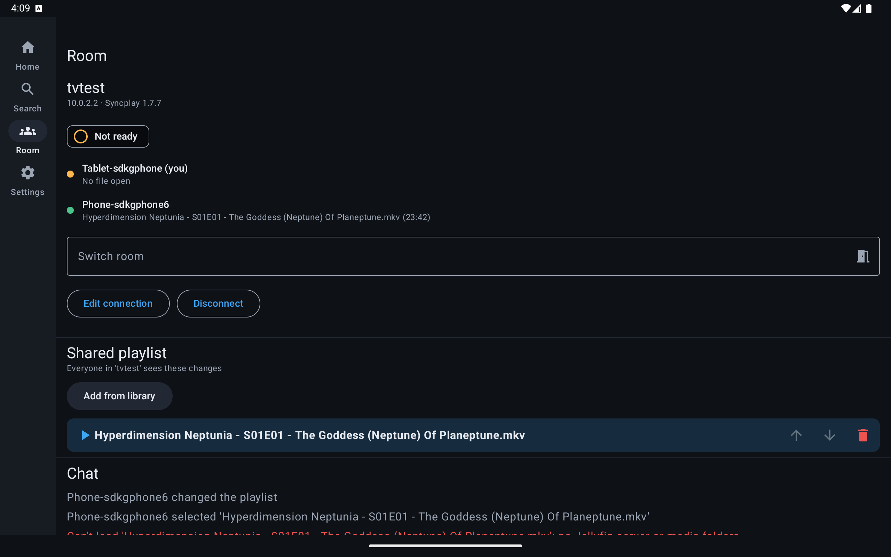

# YarmiplayTV

A [Syncplay](https://syncplay.pl/) client for Android TV / Google TV, phones, tablets and Windows, macOS and Linux
desktops, with [mpv](https://mpv.io/) built in. Media comes from your [Jellyfin](https://jellyfin.org/) and
[Plex](https://www.plex.tv/) servers or from files on the device.

New to it? The [user manual](https://tv.yarmiplay.com/manual/) explains everything step by step, and the
[patch notes](https://tv.yarmiplay.com/changelog/) list what changed in each version.

- Joins any Syncplay server/room; play, pause and seek are synchronised with desktop Syncplay users.
- Plays through libmpv (hardware decoding with software fallback, libass subtitles, audio/subtitle track switching).
- Browses Jellyfin libraries (Quick Connect or username/password login) and Plex libraries (link the device at
  plex.tv/link, then pick a server). You can stay signed in to several Jellyfin and several Plex servers at once
  (add or sign out of each under Media servers); their libraries show side by side, home has a "Continue
  watching" row per server, and searches cover all of them. You still join one Syncplay room at a time. Files
  are always played as the original file (direct play), so the name matches what other Syncplay users have.
- Shared playlists: when someone selects an entry, the app finds that filename in your media folders or on your
  servers and loads it automatically. Each file is streamed from one place only: your media folders first, then
  a server with exactly that file name (Settings > Preferred server decides when several have it), and only if
  no server has the exact name, a looser match (punctuation and case ignored, then a title search). While one
  entry plays, the next is already looked up, so the playlist moves on without waiting for a search. The player's
  previous and next buttons (next to the seek buttons; on desktop also B and N or the media keys, on TV also the
  remote's previous and next keys) select the neighbouring entry for everyone, wrapping around when the playlist
  loops; in a managed room only operators can.
- Reports what you watch back to your servers: progress while playing, and "watched" once 90% is played. When
  several servers have the same file, each is told, also when the file plays from your media folders.
  The app never jumps to a server's saved position, since the room decides where playback is. Turn reporting
  off with Settings > Report progress to your media servers.
- Syncplay's managed rooms, on servers that support them (the official server and YarmiplayServerTV 1.7.1+):
  **Create managed room**, on the join form or in the room panel, makes one and gives you its operator password
  to share (the room's full name and the password each have their own copy button), and **Operator password**
  makes you an operator of the managed room you're in (or type it on the join form when joining a `+name:HASH`
  room). Only operators play, pause, seek or change the playlist; everyone else follows, and operators can mark
  others ready or not ready. Passwords are remembered per server and room and sent again whenever you rejoin,
  and a room created from the join form is saved as the one to join next time. Managed rooms show their chosen
  name with a lock instead of the hash. The Room tab lists the shared playlist first, then the chat, the
  people in the room, and last switching rooms. On a computer or a wide tablet the Room tab shows the playlist,
  the chat and the room side by side.
- Themes, in Settings > Appearance: Dark (the app's night blue), Noire (dark purple),
  Monochrome (true black and white, for OLED screens), Light, Ember (warm black and copper), Snow (dark slate and pale ice), Grass (leaf green), Sky (bright blue), or Match the system. The whole app recolours at once,
  title bar, Android system bars and the player's panels included; what's written on the video stays white, on
  see-through black, so it reads on any picture.
- Saved and recent rooms: every room you join is kept as a recent room (the 15 latest), and **Save this room**
  (a star, or a checkbox on the join form) keeps one for good, with a name of your own if you like. Both lists
  are on the join form, with **Rejoin** to connect in one click, and the room panel has the other rooms on the
  same server to switch to. The home screen's room card says which room it would rejoin.
- MyAnimeList: sign in from the MyAnimeList card on the home screen (or Settings > MyAnimeList) and your list
  follows what you watch. Once you're signed in, the card opens the MyAnimeList screen: a search for any show (to
  add it to your list, change its status, score and episodes, or remove it; also in the player's MyAnimeList
  panel), your list (watching, plan to watch, completed) with episode and score changes, the update switches, the shows you matched or stopped
  tracking, and updates waiting to be sent. When an episode is 90%
  watched, its progress is updated (and the show's status: watching, or completed with a finish date at the last
  episode; a completed show you watch again counts as a rewatch), with Undo, or after asking if you prefer. The
  app works out which MyAnimeList entry an episode is, from your media server (or the file and folder names):
  MyAnimeList has an entry per season, so season 2 episode 5 is the second season's entry, and an episode
  numbered from the start of the show (episode 50, say) is counted through the seasons to the right one: episode
  27 of a show whose first two seasons have 12 episodes each is season 3 episode 3. It follows MyAnimeList's
  prequel and sequel links for the order, skips recaps, movies and specials, counts a season MyAnimeList splits
  into parts (Attack on Titan's "Season 3 Part 2") as one, matches short or slightly different library names,
  and trusts a show that's already on your list. Only when it still isn't sure does it ask you to pick, and it
  remembers your choice for the show. The player's MyAnimeList panel shows
  the entry and lets you change the episodes watched, status and score, fix a wrong match or stop tracking a show;
  shows in the library have it too. You sign in on MyAnimeList's own page (in your browser on desktop, or on Android
  in a web view); the app keeps only its tokens, on the device, and signing out deletes everything it kept. Builds need a
  MyAnimeList Client ID (`MAL_CLIENT_ID` in `~/.gradle/gradle.properties` or the CI secret; never in the
  repository), registered with the redirect URL `http://localhost:47821/mal-callback`.
- Skips openings and endings, found from the file's chapters ("Opening", "ED", "Credits"…), the media server's
  markers (Jellyfin 10.10 media segments, Plex intro and credits markers), for anime AniSkip's times for the
  episode MyAnimeList says is playing (no account needed), or else by listening: the start and end of the episode
  are fingerprinted (Chromaprint's method, our own Kotlin code) and compared with the episodes before and after it,
  and the stretch they share is the opening or ending song. Fingerprints stay in the app's cache, so the next episode
  is usually instant; server episodes are only read on Wi-Fi or Ethernet unless allowed on mobile data. They're
  marked on the seek bar. A Skip button shows for
  3 seconds as one starts (S on desktop, OK on a TV remote), or they're skipped by themselves.
  Automatic skipping is a room setting: on YarmiplayServerTV (1.7.3 or later) it's the room's, the same for
  everyone and changed only by operators in a managed room; on other servers each device decides, and a skip
  moves the room like any seek. A saved room remembers it and turns it on again when joined. Watching alone,
  Settings > Playback decides, and can also hide the button.
- Like Syncplay, it warns when someone's copy of a file differs from yours: the playlist marks the entry when
  their file size differs (with both sizes when they're shared), and the room list says whether the name, size
  or duration differ. It's only a warning; playback and sync carry on as usual.
- One APK: the remote-friendly TV UI on Google TV, a touch UI on phones (bottom navigation) and tablets
  (navigation rail). On phones and tablets you can also open a single video, use "Open with" from a file
  manager, or add media folders that work like Syncplay's media directories; their videos show a preview
  frame. The player has the TV's thin seek bar and a volume slider, and the Player tab opens it from any screen.
- A desktop app with the same UI plus a side panel that edits the room's playlist and chats the way the
  desktop Syncplay client does.
- Each room's playlist is remembered per server and put back when you rejoin a room whose playlist is empty
  (Settings > Remember room playlists).
- On a [YarmiplayServerTV](https://servertv.yarmiplay.com/) server (1.6.0 or later) it also uses that server's
  extensions; on any other Syncplay server it behaves exactly as above:
  - Device access: the host approves each device once (it shows a code to compare), after which it joins
    without the password. Settings > Device name sets what the host sees; the connect screen can forget the key.
  - File relay: someone who doesn't have the playlist's file streams it from a viewer who does, through the
    Syncplay server, or downloads it first when the connection is too slow to play it smoothly. When the
    playlist's next entry can only come through the relay, its start (about a minute) and its end are fetched
    ahead while the current one plays, so it starts at once. Relayed files
    are cached for at most 24 hours (up to 4 GB) and deleted when you leave the room. Settings > Share my files
    with the room stops this device from offering its files; it can still play files others share.
  - Found on your network: the join form lists the YarmiplayServerTVs on your Wi-Fi or Ethernet (1.7.2 and later
    answer a broadcast on the Syncplay port; stock Syncplay servers don't), and picking one fills in its name and port.
    Nothing is broadcast over mobile data.
  - At home without NAT loopback: a server with a certificate (e.g. `myname.duckdns.org`) tells the app its own
    addresses inside its network. When the name doesn't lead back in from home, the app connects to one of those
    instead, with TLS still verified against the name ("Connected at home via 192.168.1.20 · verified as …" in the
    room panel); away from home nothing changes. If nothing answers, it looks for the server on the network. Typing
    the server's LAN IP works with TLS too: it's verified as the name the server gives, and saved under that name so
    it also works away from home. Certificates are always verified; only the name they're checked against changes.
  - A Jellyfin server the host shares is added automatically, as "<name> (via <server>)"
    (Settings > Add media servers shared by Syncplay hosts).



## Download

The [download page](https://tv.yarmiplay.com/) has a card per platform (Android, which covers
Google TV, phones and tablets with one APK; Windows; macOS; Linux) and highlights the one for the device you
open it on, with the TV steps first on a TV. On a TV, enter
`https://tv.yarmiplay.com/a` in the Downloader app to get the APK directly.

To host your own Syncplay and Jellyfin servers from a Windows, macOS or Linux computer, use
[YarmiplayServerTV](https://servertv.yarmiplay.com/)
([source and setup guide](https://github.com/Yarmiplay/YarmiplayServerTV#readme)).

The page is built by `scripts/download_site.py` and published by `.github/workflows/pages.yml` after every
green `Build` run on `main` and after every `Release` run (or by hand from the Actions tab). It contains every
artifact of that run whose name starts with `yarmiplaytv-`, except that the Windows `.msi` and portable zip
come from the latest GitHub release.
Files are matched to platforms by extension (`.apk`, `.msi`/`.zip`, `.dmg`/`.pkg`, `.deb`/`.rpm`/`.AppImage`).
Each card's main button is its store listing or first file, with the other files as links below it; Android's
is the Google Play testers page (`/test/`) while the app is in its closed test. Platforms
without a package show how to run from source. The page's `version.json` lists each platform's package,
version and SHA-256 for the apps' update check (see [Updates](#updates)). For search engines the page has
a description, canonical URL, link-preview image and app structured data, and the site a `sitemap.xml`; it
is registered in Google Search Console, whose HTML-tag token is the repository variable
`GOOGLE_SITE_VERIFICATION`. After each deploy the workflow notifies [IndexNow](https://www.indexnow.org/)
(Bing, DuckDuckGo, Yandex) with the key in `pages.yml`, published as `<key>.txt`. To preview it locally:

```powershell
python scripts/download_site.py --dist app/build/outputs/apk/debug --out build/site
python -m http.server -d build/site 8000
```

### Updates

When it starts, the app from the download page reads `version.json` and shows a notice on the home screen if
its platform's package has a higher version than the one running (so only bumping `appVersion` makes an
update; builds of the same version don't). **Settings > Updates > Check for updates** does the same on
request, also for a version whose notice was dismissed. Every download's SHA-256 is checked against
`version.json` before anything is installed, and an installer that fails isn't tried again on that start.

| Installed from | Installing |
|---|---|
| Windows `.msi` (or winget) | Downloads the `.msi` and installs it per user (no administrator prompt) after the app closes, then starts the new version with the same arguments |
| Windows portable `.zip` | Downloads the zip (`windows-portable` in `version.json`) and, after the app closes, replaces `app` and `runtime` next to the executable, keeping `data` |
| macOS `.dmg` | Mounts the disk image after the app closes and replaces the app bundle (asking for an administrator password only when its folder isn't writable) |
| Linux `.deb` | `pkexec apt-get install` with the downloaded `.deb`, or opens it in the software installer without pkexec |
| Android APK from the download page (phones, tablets, TVs) | Downloads the APK and hands it to Android's installer; the first time, Android asks to allow installs from YarmiplayTV |
| Google Play | Play's in-app update; the Play build never reads `version.json` |
| Microsoft Store, Flatpak, snap, AUR | Opens the store, or shows the command that updates it |

Where the app installs updates on a computer, **Automatic updates** in Settings installs a new version before
the window opens: a small window shows the download's progress (and Skip), and if the check doesn't answer
within 5 seconds or the download fails, the current version opens with the notice instead. "Check for updates
when the app starts" in Settings turns the launch check off.

The two Android builds are kept apart at build time, as Google Play's policy requires (apps from Play update
only through Play). The Play build (`release`) has `UPDATE_CHECK = false`, the Play In-App Updates library
(`releaseImplementation`) and none of the APK installer; the download-page build (`debug`) has the APK installer
and `REQUEST_INSTALL_PACKAGES` in its own manifest (`app/src/debug/`) and no Play library. CI fails the build if
the release manifest ever has that permission.

After an update the home screen shows "What's new" once, from the same patch notes as the website's
[patch notes](https://tv.yarmiplay.com/changelog/) page: `packaging/linux/com.yarmiplay.TV.metainfo.xml`, turned
into `ReleaseNotes.kt` at build time.

The download page's APK is signed with a fixed key from the repository secrets
`YARMIPLAYTV_APK_KEYSTORE_BASE64` and `YARMIPLAYTV_APK_KEYSTORE_PASSWORD` (alias `yarmiplaytv-apk`), so a new
version installs over the old one and keeps its settings. Without the secrets (e.g. pull requests from forks)
CI signs with a throwaway debug key.

## Desktop app

Installers come from the `desktop` CI job (and the download page):

- **Windows:** the [Microsoft Store](https://apps.microsoft.com/detail/9PDBVR6W069J) (signed, updated by the
  Store), the `.msi`, installed per user, or `winget install Yarmiplay.YarmiplayTV`; uninstall from
  Settings > Apps. Or the portable `YarmiplayTV-<version>-portable.zip` (`:desktop:packagePortableZip`):
  unzip it anywhere and run `YarmiplayTV.exe`; it keeps its settings in the `data` folder next to it instead
  of `%APPDATA%\YarmiplayTV`. libmpv is included in all of them. The `.msi` and zip aren't code signed, so
  browsers and SmartScreen warn about them; the Store and winget copies don't.
- **macOS:** `.dmg` (Apple Silicon, not notarized: right-click the app and choose Open the first time).
  It uses Homebrew's libmpv, so run `brew install mpv` first.
- **Linux:** `.deb` for Ubuntu 22.04+ and Debian 12+ (also on each GitHub release from the next one on);
  `sudo apt install ./yarmiplaytv_*.deb` also installs libmpv. Store packages are on their way (see
  [Linux stores](#linux-stores)); once they are listed, they install with
  `flatpak install flathub com.yarmiplay.TV`, `sudo snap install yarmiplaytv` or, on Arch,
  `yay -S yarmiplaytv-bin`. The Flatpak and the snap include libmpv; all three update with the system and
  don't check the download page.

Open a video from the home screen, drop files or folders on the window, or use "Open with" on a video.
In a room, the player's playlist, room and chat buttons open a side panel:

- **Playlist:** add videos, a folder or URLs, drop files while the tab is open, drag or Alt+↑/↓ to
  reorder, Ctrl/Shift-click to select several, Delete to remove, Ctrl+Z to undo (anyone's last change),
  double-click to play, shuffle, sort A to Z (numbers in number order; also on phones and TV, with Undo), loop
  options, and save/load the list as a text file.
- **Chat:** Enter in the player opens it; ↑/↓ recall what you sent.

Player keys: Space or K pauses, ←/→ or J/L seek, ↑/↓ change the volume (also the scroll wheel and the volume
slider in the player's bar), M mutes, N and B (or the media keys) go to the playlist's next and previous entry,
F or F11 toggles full screen, F5 saves a screenshot to
Pictures\YarmiplayTV or the folder picked under Settings > Save screenshots to (the camera button in the player's
bar does too, also on Android, where they go to Pictures/YarmiplayTV unless another folder is picked), H hides or shows the controls (they also hide after 2 s unless the mouse is on them), P (or the
picture-in-picture button in the player's top bar) moves the video to a picture-in-picture window: small,
borderless and always on top, in the corner of the screen (or where you left it), while the main window stays
free to browse, chat or change settings. Hovering it shows the title, play/pause, a seek bar, the volume, the way
back and close; drag it to move it, drag its corner to resize it (it keeps the video's shape), and double-click it
or press Esc to go back to the app. Space, ←/→, ↑/↓ and M work in it too. Minimizing the app while a video plays
opens it as well (Settings > Picture-in-picture when minimized), and restoring the app brings the video back. Esc
leaves full screen or goes back. The command line follows the official client:
`YarmiplayTV [--host host[:port]] [--name name] [--room room] [--password pw] [file]`.

From source (downloads the pinned libmpv on Windows; use `brew install mpv` or `sudo apt install libmpv2`
elsewhere):

```powershell
./gradlew :desktop:run --args="--host localhost:8999 --room tvtest D:/Videos/episode.mkv"
./gradlew :desktop:packageDistributionForCurrentOS     # installers in desktop/build/compose/binaries
./gradlew :player-mpv-desktop:test :desktop:test       # libmpv playback, the side panel (needs SYNCPLAY_TEST_SERVER)
./scripts/e2e-desktop.ps1                              # phone leads; TV and desktop follow; official client watches
```

## Project layout

| Module | What it is |
| --- | --- |
| `syncplay-protocol` | Pure Kotlin Syncplay protocol client (JSON over TCP, optional TLS) |
| `media-source` | `MediaSource` interface with the Jellyfin and Plex implementations, and a combined view for browsing several servers (pure Kotlin, OkHttp) |
| `player-mpv` | libmpv wrapper exposing a small `Player` interface |
| `shared` | Kotlin Multiplatform (Android and desktop): phone/tablet/desktop UI, `SyncController`, `PlaylistController`, settings, local library |
| `app` | The Android app: TV UI (Compose for TV) and the Android side of `shared` |
| `player-mpv-desktop` | libmpv on the desktop through JNA, rendered with OpenGL (or software) into Compose |
| `desktop` | The desktop app (Compose for Desktop): window, shortcuts, drag and drop, installers |
| `web` | The browser version at tv.yarmiplay.com/watch (Svelte and TypeScript): its own player (FFmpeg in WebAssembly for demuxing and the codecs browsers lack, WebCodecs for hardware decoding, libass for subtitles) and the Syncplay client over a WebSocket to YarmiplayServerTV. `npm install`, `npm run dev`, `npm test`; `npm run libav` builds its FFmpeg (needs emsdk) |

## Development on Windows

```powershell
# One-time: JDK 17, Android SDK, emulator, Google TV and phone system images
./scripts/setup-toolchain.ps1

# One-time: create the emulators (GoogleTV_1080p, GoogleTV_4K, Phone_Pixel8, Tablet_Pixel)
./scripts/create-avds.ps1                 # or -Kind tv / -Kind phone,tablet

# Build, boot the emulator, install and launch (prints the serial, e.g. emulator-5556)
./scripts/run-tv.ps1                      # 1080p Google TV
./scripts/run-app.ps1 -Avd Phone_Pixel8   # phone; boots next to a running TV
./scripts/run-app.ps1 -Avd Tablet_Pixel -NoBuild
./scripts/run-app.ps1 -Avd Phone_Pixel8 -Ui tv   # debug: force the TV UI

# Send remote-control keys to the emulator
./scripts/remote.ps1 down down ok back
./scripts/remote.ps1 -Text "Neptunia"

# Touch input: tap/swipe by coordinates, rotate the screen
./scripts/remote.ps1 -Serial emulator-5554 tap 540 1200 swipe 540 1800 540 600 rotate landscape

# Tap by visible text, content description or Compose test tag (works in the system file picker too)
./scripts/ui.ps1 -Serial emulator-5554 -List
./scripts/ui.ps1 -Serial emulator-5554 -Id tab_Room
./scripts/ui.ps1 -Serial emulator-5554 "Use this folder" -Wait 10

# Screenshot an emulator (saved under %TEMP%\yarmiplaytv-shots, path is printed)
./scripts/screenshot.ps1 -Name home
./scripts/screenshot.ps1 -Serial emulator-5554 -Name phone-home
```

With several emulators running, pass `-Serial` to the scripts. The phone and tablet images include the
Play Store's Gboard, whose stylus tutorial swallows scripted text; `run-app.ps1` turns it off.

### Installing on a real TV

```powershell
./scripts/serve-apk.ps1            # builds the debug APK and serves it on port 8080
```

It serves the same download page as GitHub Pages, with your local build. On the TV, open the printed
`http://<pc-ip>:8080/` in a browser, or install the free **Downloader** app
(by AFTVnews) and enter `http://<pc-ip>:8080/a` for a direct download. Allow that app to install unknown apps
when Android asks, then open the file and choose Install. Re-run the script after changes and download again
to update. Debug builds are signed with this PC's debug key, so an APK from CI (different key) can't update a
locally built install without uninstalling first.

In the TV player, OK, ↓ or Menu shows the controls and ↓ or Menu hides them again; with them hidden, ←/→ seek
and ↑ opens the room panel. Back closes a panel and returns to the controls (on the button that opened it), then
hides the controls. While a video plays they hide by themselves after 3 seconds; Settings > Playback > Hide
player controls after offers 2, 3, 5 or 10 seconds, Never, or a custom time.

### Installing on a phone or tablet

It's the same APK. With the server above running, open `http://<pc-ip>:8080/` in the phone's browser, tap
the download, and allow the browser to install unknown apps when asked. With USB debugging enabled you can
also run `adb install -r app/build/outputs/apk/debug/app-debug.apk`.

On a phone or tablet:

- **Local files.** Use "Files on this device" to open a single video, or add a folder such as `Movies`.
  Each video in a folder shows a preview frame from a tenth of the way in (also on desktop).
  When the room's playlist moves to a file, the app looks for that filename in your folders first, then on
  Jellyfin and Plex, so a friend's desktop Syncplay sees the same file.
- **Player.** The Player tab (bottom bar or rail, also on desktop) opens the player from any screen; Back
  returns to where you were. The player goes fullscreen in landscape. Tap to show the controls. Double-tap the
  left or right side to seek, or the middle to pause. Tap or drag the thin seek bar, as on the TV, to seek;
  the slider next to the mute button sets the device's media volume and follows the volume buttons. The
  playlist, room, chat and track panels open as bottom sheets.
- **Picture-in-picture.** Leaving the app while a video plays (Home, or switching apps) shrinks it into a
  small window over other apps, which keeps playing in sync with the room; the button in the player's top bar
  does it by hand. The window has a play/pause button (in a room it pauses everyone, like the one in the
  player). Closing the window pauses a video you watch alone. Turn the automatic part off under Settings >
  Picture-in-picture when leaving the app. The same works on Android TV devices that support it.
- **Background playback.** Without picture-in-picture, keep the app in front while watching. Android cuts
  network access for apps in the background, so the room connection drops after a few seconds. It
  reconnects and resyncs automatically when you come back.

Inside the emulator, the host PC is `10.0.2.2`, so a Jellyfin server on this PC is `http://10.0.2.2:8096`
and a Syncplay server on this PC is `10.0.2.2:8999`. The player overlay auto-hides after 3 seconds (by
default), so send key sequences in a single `remote.ps1` call.

### Unit and integration tests

```powershell
./gradlew :syncplay-protocol:test :media-source:test

# Protocol test against a real syncplay-server (see below)
$env:SYNCPLAY_TEST_SERVER = "127.0.0.1:8999"; ./gradlew :syncplay-protocol:test

# Live Jellyfin test (optional)
# (API key from Jellyfin Dashboard > API Keys, user id from the user's profile URL; keep these out of the repo)
$env:JELLYFIN_URL = "http://localhost:8096"; $env:JELLYFIN_TOKEN = "..."; $env:JELLYFIN_USER_ID = "..."
$env:JELLYFIN_RESOLVE = "Some Show - S01E01 - Title.mkv"
./gradlew :media-source:test --tests "*LiveJellyfinTest*"

# YarmiplayServerTV extensions against real servers (each variable is optional; unset ones skip their tests).
# Needs a YarmiplayServerTV checkout next to this repo. The relay server is its example; the device-access
# servers are scripts/yarmiplay-device-server, which approves devices named "...approve...", denies
# "...deny..." and revokes users named "...revoke...".
# Each server in its own terminal:
cd ../YarmiplayServerTV/src-tauri; cargo run --example syncplay_server -- 18999       # file relay
cd scripts/yarmiplay-device-server; cargo run -- 18997 password secret                 # password or approval
cd scripts/yarmiplay-device-server; cargo run -- 18996 approved                        # approved devices only
cd scripts/yarmiplay-device-server; cargo run -- 18995 password secret --vanilla       # vanilla Syncplay mode
./scripts/local-syncplay-server.ps1 -Port 18998                                        # stock Syncplay
./scripts/local-syncplay-server.ps1 -Port 18994 -Password secret                       # stock, with a password
$env:YARMIPLAY_TEST_SERVER = "127.0.0.1:18999"
$env:YARMIPLAY_FAKE_PEER = "../YarmiplayServerTV/scripts/fake_peer.py"
$env:YARMIPLAY_PASSWORD_SERVER = "127.0.0.1:18997:secret"; $env:YARMIPLAY_APPROVED_SERVER = "127.0.0.1:18996"
$env:YARMIPLAY_VANILLA_SERVER = "127.0.0.1:18995:secret"
$env:SYNCPLAY_TEST_SERVER = "127.0.0.1:18998"; $env:SYNCPLAY_PASSWORD_SERVER = "127.0.0.1:18994:secret"
./gradlew :shared:desktopTest --tests "*YarmiplayServerTest*"
```

### Instrumented tests (phone emulator)

Compose UI and playback tests in `app/src/androidTest` cover:

- device detection;
- navigation;
- the connect and settings forms;
- player gestures and sheets;
- playing a generated test clip through a `content://` URI.

Run them on a booted `Phone_Pixel8`:

```powershell
./gradlew :app:connectedDebugAndroidTest
```

If Gradle can't clean its result folders (OneDrive sometimes locks them), install both APKs and run the
tests through adb instead:

```powershell
./gradlew :app:assembleDebug :app:assembleDebugAndroidTest
adb install -r -t app/build/outputs/apk/debug/app-debug.apk
adb install -r -t app/build/outputs/apk/androidTest/debug/app-debug-androidTest.apk
adb shell am instrument -w -r com.yarmiplaytv.test/com.yarmiplaytv.YarmiplayTestRunner
```

CI (`.github/workflows/build.yml`) does four things:

- runs the unit tests and the protocol test against a real Syncplay server;
- runs the instrumented tests on an API 34 phone emulator;
- tests the desktop app on Windows, macOS and Ubuntu, builds its installers, and installs and plays the
  `.deb` on Ubuntu;
- uploads the debug APK as an artifact, which `pages.yml` then publishes on the download page.

### Testing sync locally

```powershell
./scripts/local-syncplay-server.ps1    # clones Syncplay, runs its server on port 8999
```

Connect the TV app to `10.0.2.2:8999` and join a room (e.g. `tvtest`). A phone emulator running next to it
can join the same room. Push a video with `adb -s emulator-5554 push episode.mkv /sdcard/Movies/` and add
the `Movies` folder in the app; it then resolves that filename locally while the TV uses Jellyfin. Then either:

**A desktop Syncplay client with mpv** (run from the same source checkout, no install needed besides mpv):

```powershell
winget install shinchiro.mpv
.tools\syncplay-venv\Scripts\python.exe .tools\syncplay-src\syncplayClient.py --no-gui --no-store `
    -a 127.0.0.1:8999 -n Desktop -r tvtest --player-path "C:\Program Files\mpv\mpv.exe" "D:\path\to\episode.mkv"

# Drive that desktop mpv from a script (play / pause / seek / get <property>)
python scripts/mpv_ipc.py seek 600
python scripts/mpv_ipc.py get time-pos
```

**Or the scripted peer** `scripts/fake_peer.py` (stdlib only), which speaks the protocol with a virtual clock and
fails with exit code 1 when an expectation isn't met:

```powershell
python scripts/fake_peer.py --room tvtest --name Peer --script (
  "wait 2; playlist Some Show - S01E01 - Title.mkv; select 0; wait 10; expect-user TV ready=true; " +
  "ready; play; expect-room paused=false; seek 300; expect-room position~300; wait 3; drift -7; wait 4; status; quit")
```

The TV should resolve the playlist entry through Jellyfin, load it, report the same file and mark itself ready,
then follow the peer's unpause and seek, slow down for small drifts and rewind for large ones.


## Releasing to Google Play

Bump the version with `python scripts/bump-version.py 1.5.0 --notes "What changed"`: it sets `appVersion` in
`app/build.gradle.kts` (the Android `versionCode` follows from it) and `desktop/build.gradle.kts`, and adds the
release to the Linux metainfo, which the release needs (`--android-only` / `--desktop-only` bump one of them).
Run the full `scripts/android-safety-net.ps1`, then push a tag matching the Android version:

```powershell
git tag v1.5.0; git push origin v1.5.0
```

`.github/workflows/release.yml` builds the app bundle signed with the upload key from the repository secrets
`YARMIPLAYTV_KEYSTORE_BASE64`, `YARMIPLAYTV_KEYSTORE_PASSWORD`, `YARMIPLAYTV_KEY_ALIAS` and
`YARMIPLAYTV_KEY_PASSWORD`, and attaches `yarmiplaytv-<version>.aab` to the run for uploading in the Play Console.
With the variable `PLAY_TRACK` and the secret `PLAY_SERVICE_ACCOUNT_JSON` it uploads the bundle to that track
itself (see [automatic uploads](docs/play/README.md#automatic-uploads)).
Locally, `:app:bundleRelease` signs with the key named in a gitignored `keystore.properties` at the repository
root (`storeFile`, `storePassword`, `keyAlias`, `keyPassword`). The store listing, graphics and policy answers
are in [docs/play](docs/play/README.md); the privacy policy is [docs/privacy.md](docs/privacy.md), published at
`/privacy/` on the download page.

The same tag builds the Windows `.msi` and portable zip, attaches them to the tag's GitHub release and republishes the
download page with them. They aren't code signed: browsers and SmartScreen warn about them, winget and the
Store package don't.

The workflow is ready for code signing through [SignPath](https://signpath.io), which isn't set up yet. To turn
it on: create a SignPath project with the slug `YarmiplayTV`, linked to the GitHub.com trusted build system,
with a `release-signing` policy and
[.github/signpath/artifact-configuration.xml](.github/signpath/artifact-configuration.xml) as its default
artifact configuration. Then set the repository variable `SIGNPATH_ORGANIZATION_ID` and the secret
`SIGNPATH_API_TOKEN` (a SignPath CI user with submitter rights). Each release then waits up to 6 hours for an
approver to accept the signing request, checks the signed `.msi` and launchers, and releases those. Signing
through the SignPath Foundation also needs a "Code signing policy" section in this README (who commits,
reviews and approves, and what gets signed), linked from the download page's footer in
`scripts/download_site.py`.

### winget

The first version is submitted by hand: with [wingetcreate](https://github.com/microsoft/winget-create)
(`winget install Microsoft.WingetCreate`), run, for the latest release's version:

```powershell
wingetcreate new https://github.com/Yarmiplay/YarmiplayTV/releases/download/v1.4.0/YarmiplayTV-1.4.0.msi
```

with the identifier `Yarmiplay.YarmiplayTV`, scope `user` (the `.msi` installs per user) and the `.msi` only,
and let it open the pull request to `microsoft/winget-pkgs`. Once that is merged, set the repository variable
`WINGET_PACKAGE_ID` to `Yarmiplay.YarmiplayTV` and the secret `WINGET_TOKEN` to a classic personal access
token with the `public_repo` scope of an account with a fork of `microsoft/winget-pkgs`; each release tag then
opens the update pull request itself. Installs from winget update themselves like the downloaded `.msi`.

### Microsoft Store

The app is [YarmiplayTV on the Microsoft Store](https://apps.microsoft.com/detail/9PDBVR6W069J) (Store ID
`9PDBVR6W069J`). The release run also has a `windows-store-msix-<version>` artifact: an unsigned `.msix` of the same app,
which the Store signs when it is uploaded in [Partner Center](https://partner.microsoft.com/dashboard) (a free
individual developer account). [desktop/msix/AppxManifest.xml](desktop/msix/AppxManifest.xml) needs the
Identity Name, Publisher and PublisherDisplayName that Partner Center shows under Product identity for the
reserved name. The submission asks for the privacy policy (`/privacy/` on the download page), a reason for the
`runFullTrust` capability (a desktop media player built on libmpv), screenshots and the age rating. The Store
build doesn't look for updates; the Store updates it. With the variables `MSSTORE_TENANT_ID`,
`MSSTORE_SELLER_ID` and `MSSTORE_CLIENT_ID` and the secret `MSSTORE_CLIENT_SECRET`, each release tag submits the
package for certification itself (see [automatic submission](docs/store/README.md#automatic-submission)).

`scripts/make-msix.ps1` builds the same package locally (needs the Windows SDK), and
`scripts/make-msix.ps1 -Register` installs it unpacked instead for a check (needs Developer Mode).

### Linux stores

The tag also builds `yarmiplaytv_<desktop version>_amd64.deb` (on Ubuntu 22.04, so it installs on newer
releases too) and attaches it with its `.sha256` to the release, where the download page takes it from. The
AUR package and the snap repackage that `.deb`; the Flatpak builds the tag from source. Their metadata is in
[packaging/linux](packaging/linux) (AppStream metainfo with a `<release>` per desktop version, and the desktop
entry), and the [Linux packages](.github/workflows/linux-packages.yml) workflow builds all of them from a
commit, installs them and plays a clip, without publishing. Each store job in the release workflow stays off
until its variable is set; a manual Release run with the `aur`, `snap` or `flathub` input publishes the latest
release again.

- **AUR** ([packaging/aur/PKGBUILD](packaging/aur/PKGBUILD)): create an account on
  [aur.archlinux.org](https://aur.archlinux.org/register) and add the public half of a new SSH key (without a
  passphrase) to it. Set the secret `AUR_SSH_PRIVATE_KEY` to the private half and the variable `AUR_PACKAGE`
  to `yarmiplaytv-bin`; the next release creates the package.
- **Snap Store** ([snap/snapcraft.yaml](snap/snapcraft.yaml)): with a [Snapcraft](https://snapcraft.io)
  account, run `snapcraft register yarmiplaytv`, then
  `snapcraft export-login --snaps yarmiplaytv --acls package_access,package_push,package_update,package_release -`
  and set its output as the secret `SNAPCRAFT_STORE_CREDENTIALS` (it expires after a year by default), and the
  variable `SNAP_NAME` to `yarmiplaytv` (`SNAP_CHANNEL` picks another channel than `stable`).
- **Flathub** ([packaging/flatpak](packaging/flatpak)): the first version goes through a pull request to
  [flathub/flathub](https://github.com/flathub/flathub) (branch `new-pr`, see Flathub's
  [submission guide](https://docs.flathub.org/docs/for-app-authors/submission)). Run Release by hand with the
  `flathub` input to get the `flathub-<version>` artifact (the manifest pointing at the latest tag,
  `gradle-sources.json` and `flathub.json`) and submit those files. The app ID `com.yarmiplay.TV` needs
  yarmiplay.com verified on Flathub (a token served at
  `https://yarmiplay.com/.well-known/org.flathub.VerifiedApps.txt`). Once the app's repository exists, set the
  variable `FLATHUB_REPO` to `flathub/com.yarmiplay.TV` and the secret `FLATHUB_TOKEN` to a classic personal
  access token with the `public_repo` scope of an account with write access to it; each release then opens
  the update pull request there, merged automatically if the repository allows auto-merge.

The download page links the stores whose variable is set.

## Privacy

See the [privacy policy](docs/privacy.md). The program connects to the Syncplay, Jellyfin and Plex
servers you enter or pick (and to plex.tv to sign in to Plex and find its servers) and, when it starts, reads the latest version number from the download page on GitHub Pages; that
request carries no information about the user and can be turned off with "Check for updates when the app starts"
in Settings. The Google Play build asks Google Play instead, and only when you check for updates.

## License

The code in this repository is Apache 2.0, same as Syncplay. The Android app bundles libmpv-android, whose
FFmpeg is built with `--enable-gpl --enable-version3`, and the Windows installer bundles a GPL build of
libmpv, so those packages as a whole are distributed under the GPL 3.0 (Apache 2.0 code may be combined
with it). This repository is their corresponding source. Settings > Open-source licenses lists every
bundled component (`shared/.../ui/shared/Licenses.kt`).
