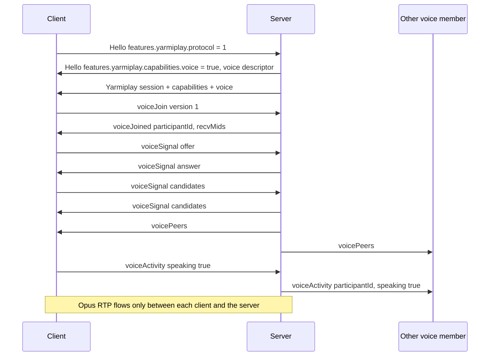

# Yarmiplay voice protocol (draft 1)

Normative draft for voice chat beside a Yarmiplay Syncplay server. YarmiplayTV 2.7.0 implements against this document. YarmiplayServerTV 2.0.0 is the first server. This is a draft for reconciliation: the message names, fields, and rules below are the proposal, not a released protocol.

Voice is not part of Syncplay. A stock Syncplay client or server never sees it. A Yarmiplay client that does not get `capabilities.voice: true` skips voice and shows nothing.

Extension protocol stays **1** (`features.yarmiplay.protocol`). Voice is a capability inside that session, negotiated as `voice.version`.

## 1. What the server does

The server is a selective forwarder (SFU), not a mixer and not a peer mesh.

- Each voice participant has one WebRTC peer connection **to the server**. Participants never exchange candidates or SDP with each other.
- Media is Opus inside DTLS-SRTP. The server terminates DTLS, so it handles plaintext RTP in memory long enough to forward it. It does not decode, mix, record, or write audio to disk or logs.
- Forwarding is per Syncplay room. A participant hears only the other voice participants in the room they are in right now, even when Syncplay room isolation is off.
- Per-person volume, local mute of someone else, the local mic mute, push-to-talk, and device choice are client-only. The server has no mute or volume messages.
- Speaking indicators are client reports, relayed as signaling. The server does not inspect audio to decide who is talking.

Wire encryption is hop-by-hop (DTLS-SRTP to the server, and TLS on the Syncplay connection when the server has a certificate). It is not end-to-end between participants. The machine running the server can hear the room, because forwarding requires it.

## 2. When voice exists

Voice is offered only when all of these are true:

- The client completed a Yarmiplay extension login (`features.yarmiplay` in Hello, vanilla mode off).
- The server's **Voice chat** setting is on.
- The voice listener is bound.

The client also has its own **Voice chat** setting. When that is off, the client does not send `voiceJoin` and does not open a peer connection. The server cannot see that setting.

Either side off means no voice UI and no voice connection.

## 3. Capability handshake

Existing Hello and `Yarmiplay` state messages gain two fields. Clients ignore unknown fields, so an older client stays silent.

`capabilities.voice` is a boolean, next to `fileRelay`, `jellyfin`, `plex`, `https`, `roomSettings`, `websocket`, and `mal`.

When `capabilities.voice` is true, the same object also carries `voice`:

```json
"voice": {
  "version": 1,
  "codec": "opus",
  "clockRate": 48000,
  "channels": 1,
  "ptime": 20,
  "maxBitrate": 32000,
  "fec": true,
  "dtx": true,
  "transport": "webrtc",
  "udpPort": 9000,
  "tcpPort": 9000,
  "maxParticipants": 8
}
```

| Field | Meaning |
|---|---|
| `version` | This document. The client echoes it in `voiceJoin`. |
| `codec`, `clockRate`, `channels`, `ptime` | The only send format. 20 ms Opus frames, 48 kHz, mono. |
| `maxBitrate` | Encoder target, bits per second. |
| `fec`, `dtx` | Opus in-band FEC on, DTX on. |
| `transport` | Always `webrtc` in version 1. |
| `udpPort`, `tcpPort` | Ports the server is listening on for media. See section 6. |
| `maxParticipants` | Voice seats in one room. Syncplay itself can have more people; extra people are not in voice. |

These appear in:

1. The Hello reply, under `Hello.features.yarmiplay`, for a client that opted in.
2. The post-login `{"Yarmiplay":{...}}` session message, and every later capabilities broadcast (the same message that already carries `capabilities`, `jellyfin`, `plex`, and `tls`).

When voice is off, `capabilities.voice` is false and the `voice` object is omitted. Turning the server toggle off, or switching on vanilla mode, broadcasts the new capabilities and then `voiceClosed` to anyone already in voice (section 5).

`GET /yarmiplay/info` does **not** advertise voice. Voice is only for a logged-in extension session.

## 4. Signaling transport

Signaling is more `{"Yarmiplay":{...}}` lines on the Syncplay connection the client already has (TCP, or TLS when the server has a certificate, or the `/yarmiplay/ws` WebSocket). One JSON object per line, `\r\n`, same limits as the rest of the extension (`MAX_LINE_LENGTH` is 64 KiB; SDP offers under that size are normal).

There is no second signaling socket. A voice message on a connection that has not finished login is ignored. Vanilla sessions are never sent these lines.

The client addresses the media listener at the **same IP or DNS name** it used for Syncplay, on `udpPort` / `tcpPort`. The server does not send a separate host field.

## 5. Messages

Unknown `Yarmiplay` keys are ignored. Unknown `voiceClosed.reason` values are treated as `error`.

### 5.1 `voiceJoin` (client to server)

```json
{"Yarmiplay":{"voiceJoin":{"version":1}}}
```

The room is the Syncplay room this connection is in. The client does not send a room name.

The server answers with `voiceJoined` or `voiceClosed`.

### 5.2 `voiceJoined` (server to client)

```json
{"Yarmiplay":{"voiceJoined":{
  "version": 1,
  "participantId": "c17",
  "username": "Alice",
  "room": "movie night",
  "recvMids": ["1","2","3","4","5","6","7"]
}}}
```

`participantId` is the server's id for this connection (`c` plus the decimal connection id). It is stable until the Syncplay connection ends.

`recvMids` is the fixed list of receive m-line ids, in order. There are `maxParticipants - 1` of them. The client creates that many recvonly audio transceivers **before** the offer, in this order, and one sendrecv audio transceiver for the microphone with mid `0`.

### 5.3 `voiceSignal` (either direction)

SDP and ICE, opaque to everyone but the WebRTC stack. The client is the offerer. The server is the answerer. The first offer happens only after `voiceJoined`.

```json
{"Yarmiplay":{"voiceSignal":{"type":"offer","sdp":"v=0..."}}}
{"Yarmiplay":{"voiceSignal":{"type":"answer","sdp":"v=0..."}}}
{"Yarmiplay":{"voiceSignal":{"type":"candidate","candidate":"candidate:...","sdpMid":"0","sdpMLineIndex":0}}}
{"Yarmiplay":{"voiceSignal":{"type":"candidate","candidate":""}}}
```

Rules:

- `type` is `offer`, `answer`, or `candidate`.
- An empty `candidate` ends trickling for that side.
- The server never forwards one client's SDP or candidates to another client.
- A signal before `voiceJoined`, or a second offer while one peer connection is up, gets `voiceClosed` with reason `error`.
- The server's answer uses mid `0` for the client's send, and mids `1..N` for the receive slots from `recvMids`. Inactive slots are `a=inactive`. Each active slot sets `a=msid:<participantId> <participantId>` of the remote participant bound to that mid.

### 5.4 `voicePeers` (server to client)

Sent to every voice participant in the room whenever the set of voice participants or their mid assignment changes, including to the participant who just joined.

```json
{"Yarmiplay":{"voicePeers":{
  "room": "movie night",
  "self": "c17",
  "peers": [
    {"participantId":"c17","username":"Alice","mid":null,"speaking":false},
    {"participantId":"c18","username":"Bob","mid":"1","speaking":true}
  ]
}}}
```

`mid` is null for `self`. For everyone else it is one of `recvMids`. The client uses `mid` to map an incoming track to a username, and uses `speaking` as the initial indicator. Later changes also arrive as `voiceActivity`.

Join and leave sounds are the client's job, played when `voicePeers` gains or loses someone other than `self`. The server ships no audio files.

### 5.5 `voiceActivity` (client to server, then server to the room)

Client, about itself only:

```json
{"Yarmiplay":{"voiceActivity":{"speaking":true}}}
```

Server, to the other voice participants in the room (not echoed to the sender):

```json
{"Yarmiplay":{"voiceActivity":{"participantId":"c17","username":"Alice","speaking":false}}}
```

The client sends `true` when its voice-activity detector or push-to-talk is open, and `false` when it closes. The server accepts at most **5** of these per participant per second and drops the rest. It does not check them against the audio.

### 5.6 `voiceLeave` (client to server)

```json
{"Yarmiplay":{"voiceLeave":{}}}
```

The client is leaving voice and staying in the Syncplay room. The server closes that peer connection, replies `voiceClosed` reason `left` to that client, and sends a new `voicePeers` to the room.

### 5.7 `voiceClosed` (server to client)

```json
{"Yarmiplay":{"voiceClosed":{"reason":"disabled","message":"Voice chat is off on this server"}}}
```

| `reason` | When |
|---|---|
| `left` | This client sent `voiceLeave`. |
| `disabled` | The server toggle went off. |
| `vanilla` | Vanilla Syncplay mode went on. The extension session ends as it does today; this line is sent first. |
| `full` | The room already has `maxParticipants` people in voice. |
| `room` | The Syncplay connection moved to another room. The old voice seat is gone. The client sends a new `voiceJoin` if it still wants voice. |
| `replaced` | A second `voiceJoin` on the same connection closed the previous peer connection. |
| `version` | `voiceJoin.version` is not 1. |
| `error` | Malformed SDP, ICE failure the server gives up on, or an internal error. `message` is a short English sentence. |

After `voiceClosed` the client drops the peer connection. It does not retry `error` or `full` on its own more than once every 10 seconds. `room` is retried immediately with `voiceJoin` if the client still wants voice. `disabled` and `vanilla` are not retried until a capabilities broadcast says voice is back.

## 6. Media

### 6.1 Codec

One format, no negotiation beyond this:

- Opus, payload type **111**, `rtpmap` `opus/48000/2` (the usual Opus rtpmap; the encoder is still mono).
- `fmtp` includes `stereo=0;useinbandfec=1;usedtx=1;maxaveragebitrate=32000`.
- 20 ms packets. The client does not send other payload types. The server drops them.

### 6.2 Peer connection shape

One `RTCPeerConnection` per voice participant.

- Transceiver mid `0`: audio, `sendrecv`, microphone. The server receives it and does not play it back to the sender.
- Transceivers mids `1..N`: audio, `recvonly`, created by the client before the offer, in the `recvMids` order. Each active mid carries exactly one remote participant. An inactive mid is `a=inactive` and carries no packets. The server does not send comfort noise on an empty seat.
- No video. No data channel. Adding either is a protocol error (`voiceClosed` reason `error`).

When a seat's occupant changes, the server updates `a=msid` on that mid with a new answer only if the mid was inactive or the occupant changed. The client applies the new `voicePeers` map even if the transceiver was already live. Occupant changes that need a new SDP are sent by the server as `voiceSignal` type `offer` (the server becomes the offerer for that renegotiation only). The client answers. Renegotiation does not drop the mic sender.

### 6.3 Transport, ports, and NAT

Default listen port is **9000**, UDP and TCP, on all interfaces, same as Syncplay's bind. It is not the Syncplay port. Syncplay stays on its own port (default 8999) so a media burst cannot stall the JSON session.

- UDP carries ordinary ICE/DTLS/SRTP.
- TCP on the same port number is ICE-TCP, for a network that blocks UDP.
- The server publishes **host candidates only**, for the address the client's Syncplay connection arrived on (and the mapped public address when the server knows it). There is no STUN or TURN server, and no third-party relay. Friends reach voice the same way they reach Syncplay: the host's port is forwarded, by hand or by UPnP.
- UPnP, when the Syncplay UPnP switch is already on and voice is on, also maps UDP 9000 and TCP 9000. UPnP failure does not clear `capabilities.voice`. The client still tries; if ICE fails it shows that voice could not connect.
- A client behind NAT does not need its own port forward. It sends to the server's forwarded port.
- DTLS setup: the client uses `setup:actpass` in the offer; the server answers `setup:active` and initiates the handshake. Fingerprints are the WebRTC ones inside SDP. A fingerprint that does not match the SDP is a failed ICE/DTLS and the server sends `voiceClosed` reason `error`.

### 6.4 Room binding and lifetime

A voice seat is tied to one Syncplay connection and one room.

- Syncplay disconnect, timeout, or kick: the server drops the peer connection with no `voiceClosed` (the signaling connection is already gone) and updates `voicePeers` for the others.
- Room change: `voiceClosed` reason `room`, then the client may `voiceJoin` again.
- Server toggle off or vanilla mode: `voiceClosed`, then the capabilities broadcast. Peer connections are closed. Nothing is written down.
- Two `voiceJoin`s on one connection: the first peer connection is closed with `voiceClosed` reason `replaced`, then the new `voiceJoined` is sent.
- The room's voice set is empty when the last voice participant leaves. That does not change the Syncplay room.

### 6.5 What is deliberately absent

- No server-side mute of another user, and no message that would mute someone for the room. Rooms have no host.
- No per-person volume, mic gain, output gain, or device id on the wire.
- No recording control, no storage, no replay.
- No voice before extension login, and no voice for a client that did not put `features.yarmiplay` in Hello.
- No mixing. Per-person volume and local mute only work if each person is a separate track.

## 7. Client behavior the server relies on

This is normative for the client, so the server can stay simple.

- Offer Opus exactly as in section 6.1. Use in-band FEC and DTX.
- Send `voiceActivity` from the local voice-activity detector (open mic) or from push-to-talk, not from both at once. Push-to-talk sends `speaking: true` only while the key or button is held.
- Map each remote mid to the username in `voicePeers` and apply local mute and volume to that track only.
- Play join and leave sounds locally when `voicePeers` changes. The sounds are original assets shipped with the client.
- If `recvMids` has no free slot, the server has already refused with `full`. The client does not invent extra transceivers.
- Hide all voice UI when `capabilities.voice` is not true, or when the client's own voice setting is off.

## 8. Sequence



## 9. Versioning

`voice.version` 1 is this document. A future change that breaks an offer, a mid layout, or a reason adds version 2 and keeps answering version 1 until clients have moved. The extension protocol number stays 1 so existing Hello parsing does not change.
